# Magnetic field examples

Run an example from the repository root to generate an interactive, offline HTML
plot. Pass an output path as the first argument, or use the default filename:

```sh
cargo run --example field_2d --features graphics-plotly
cargo run --example field_3d --features graphics-plotly -- /tmp/sphere.html
cargo run --example graphics_showcase --features graphics-plotly
```

Substitute any example name below. Use the plot toolbar's camera button to export
a PNG. Positions are in meters and magnetic fields are in tesla. Field lines use
Magba orange. Field examples exclude magnet interiors before evaluating fields.

## 2D magnitude and streamlines

[`field_2d`](../graphics/fields/2d.rs): a sphere magnet's field in the xz plane.
The white circle marks the magnet surface.

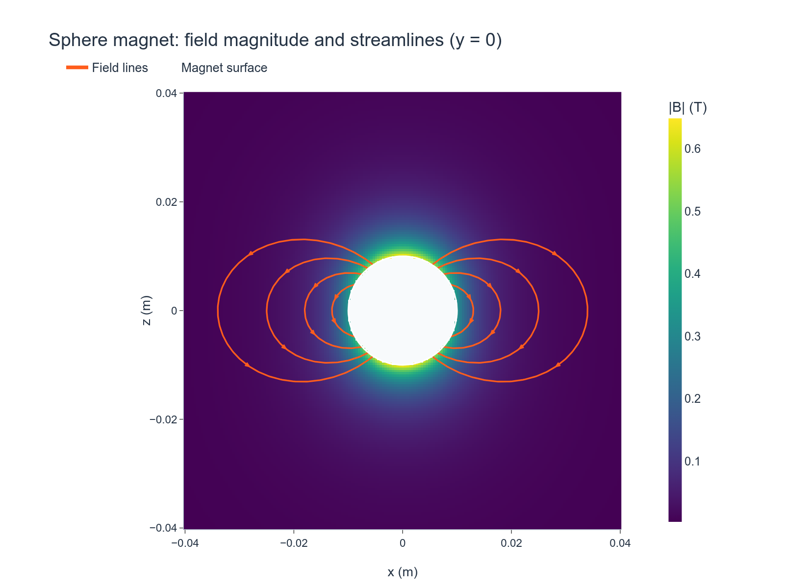

## 2D quiver

[`field_quiver`](../graphics/fields/quiver.rs): a current loop's field direction.
Equal-length arrows show direction; orange dots mark the wire cross-section.

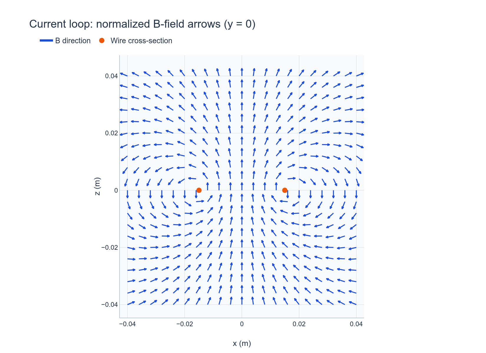

## 3D field lines and quiver

[`field_3d`](../graphics/fields/3d.rs): a sphere magnet with directed field lines
and normalized field arrows.

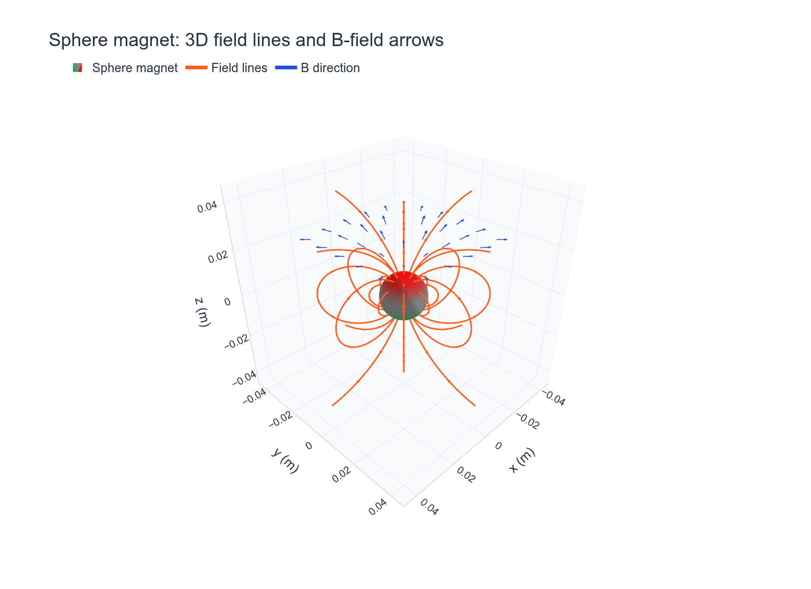

## Primitive and collection scenes

[`field_cuboid`](../graphics/fields/cuboid.rs)

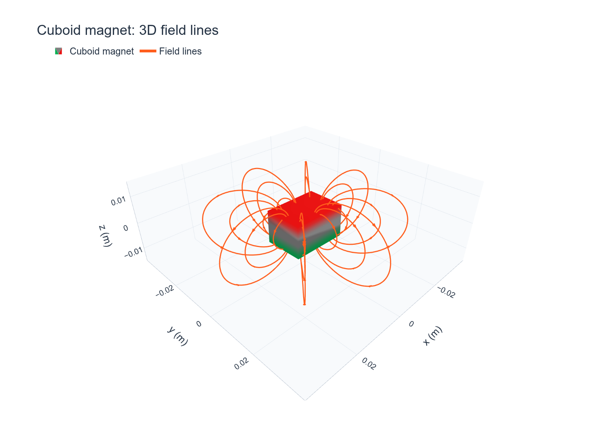

[`field_cylinder`](../graphics/fields/cylinder.rs)

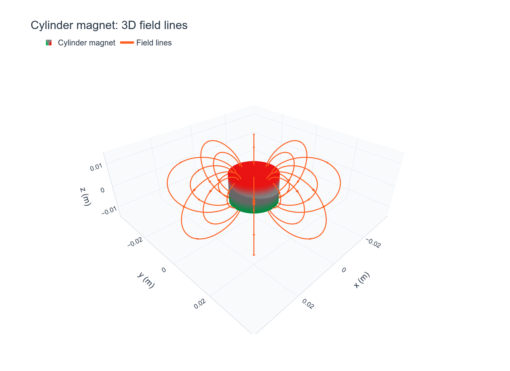

[`field_tetrahedron`](../graphics/fields/tetrahedron.rs)

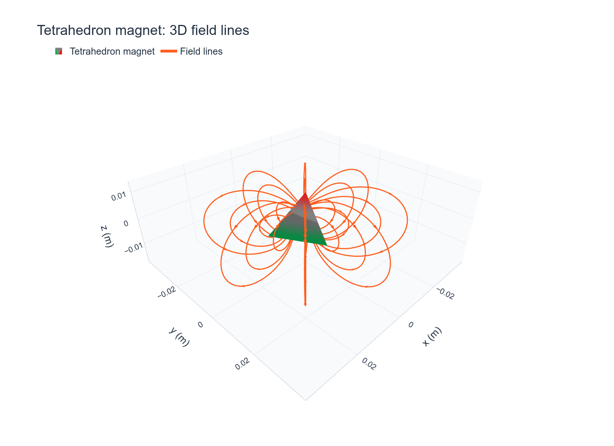

[`field_triangle`](../graphics/fields/triangle.rs)

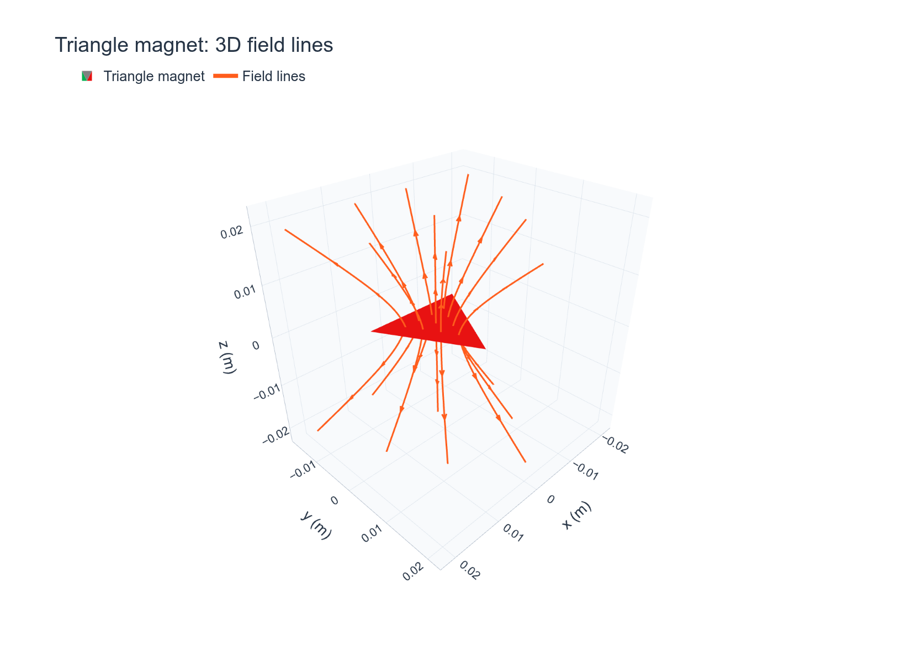

[`field_dipole`](../graphics/fields/dipole.rs)

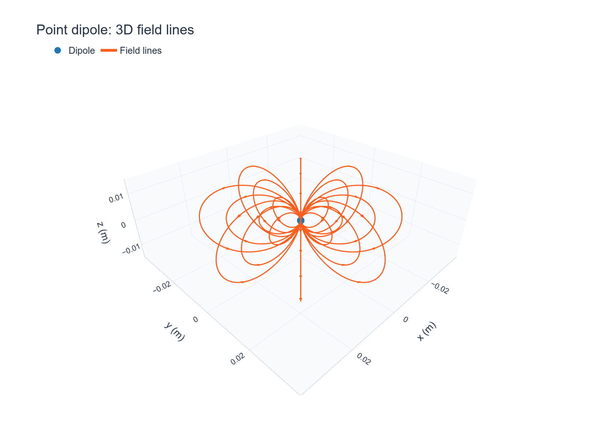

[`field_path_current`](../graphics/fields/path_current.rs)

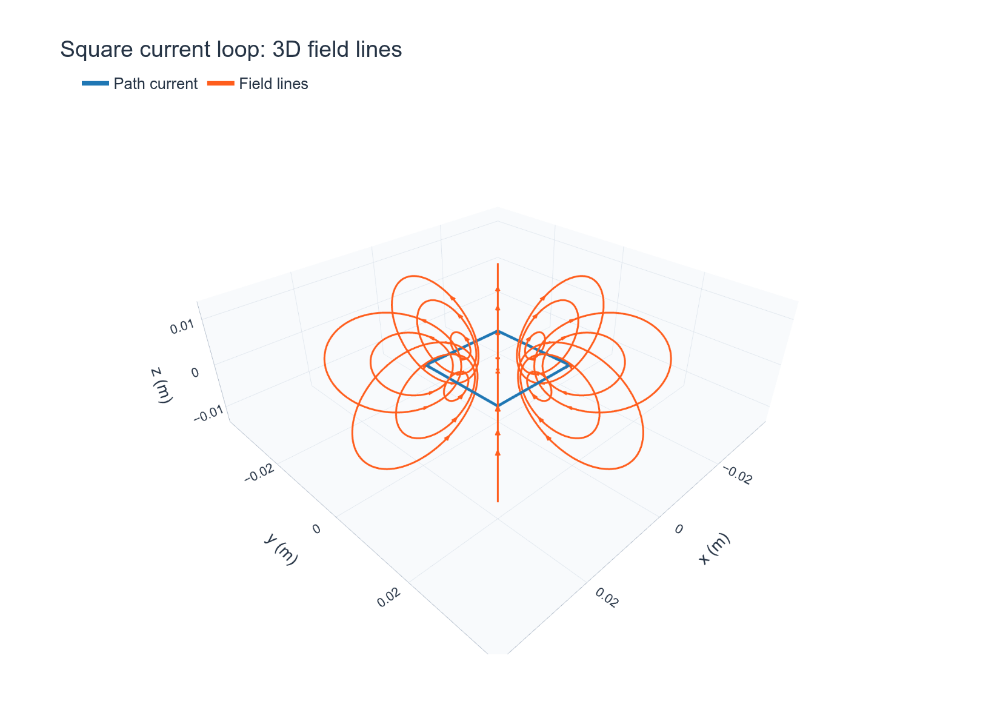

[`field_triangle_current`](../graphics/fields/triangle_current.rs)

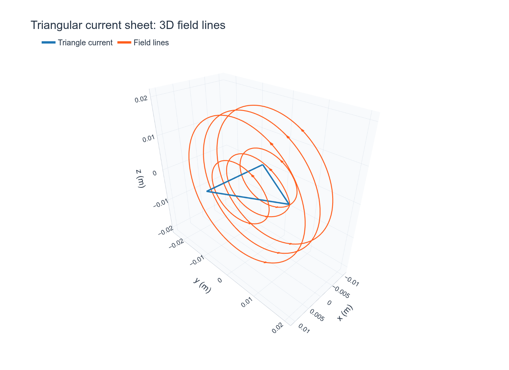

[`field_collection`](../graphics/fields/collection.rs): the combined field of two
oppositely polarized magnets and a current loop.

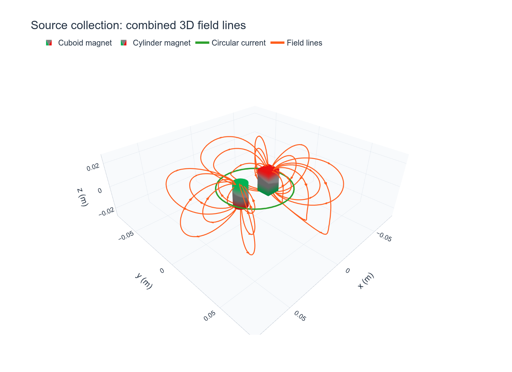

## Graphics showcase

[`graphics_showcase`](../graphics/showcase.rs): geometry, heatmaps, quivers, and
field lines in one figure. Colorbar inequalities indicate clipped display values.

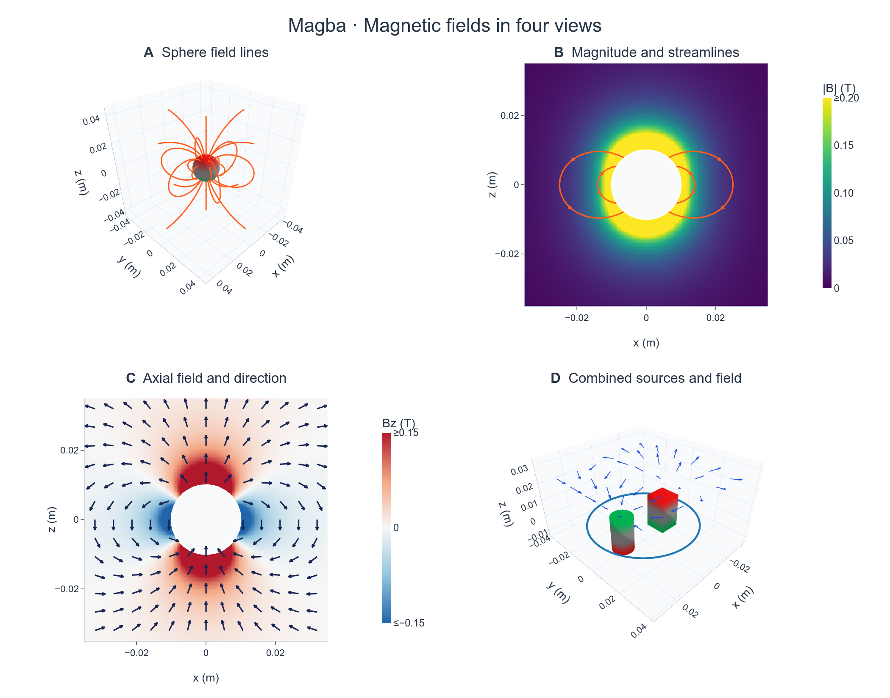

## Magnet previews

Each magnet type's Graphics documentation uses a `magnet_*.png` preview.
Run its example to generate the scene:

```sh
cargo run --example magnet_cuboid --features graphics-plotly
```

- [`magnet_cuboid`](../graphics/magnets/cuboid.rs)
- [`magnet_cylinder`](../graphics/magnets/cylinder.rs)
- [`magnet_cylinder_segment`](../graphics/magnets/cylinder_segment.rs)
- [`magnet_sphere`](../graphics/magnets/sphere.rs)
- [`magnet_tetrahedron`](../graphics/magnets/tetrahedron.rs)
- [`magnet_triangle`](../graphics/magnets/triangle.rs)
- [`magnet_dipole`](../graphics/magnets/dipole.rs)
- [`magnet_mesh`](../graphics/magnets/mesh.rs), also requiring `mesh`.

Magnet surfaces use the DIN pole palette by default. The cylinder segment preview
also demonstrates Okabe–Ito. See the [`graphics`](../graphics/appearance.rs)
example for other appearance options.

## Rustdoc previews

The `rustdoc_*.png` images illustrate the code snippets in
[`graphics::plotly`](../../src/graphics/plotly.rs) and
[`GraphicsView`](../../src/graphics/options.rs).
