# Magnetic field examples

These PNG figures are exported from the runnable Plotly examples. The HTML output
supports zoom, pan, hover, and PNG export; 3D scenes also support rotation.
Plotly.js is embedded for offline viewing. All positions are in meters and B is
in tesla.

Run from the repository root:

```sh
cargo run --example field_2d --features graphics-plotly
cargo run --example field_quiver --features graphics-plotly
cargo run --example field_3d --features graphics-plotly
cargo run --example field_cuboid --features graphics-plotly
cargo run --example field_cylinder --features graphics-plotly
cargo run --example field_tetrahedron --features graphics-plotly
cargo run --example field_triangle --features graphics-plotly
cargo run --example field_dipole --features graphics-plotly
cargo run --example field_path_current --features graphics-plotly
cargo run --example field_triangle_current --features graphics-plotly
cargo run --example field_collection --features graphics-plotly
```

Each command writes a matching HTML file in the current directory. Pass an output
path as the first argument, for example:

```sh
cargo run --example field_2d --features graphics-plotly -- /tmp/sphere.html
```

Use the plot toolbar's camera button to export a PNG. The figures below were
exported at 1100 × 800 with a scale factor of 1.5.

## 2D magnitude and streamlines

[Source](../field_2d.rs). A sphere magnet with a 20 mm diameter and 1 T polarization
along z, sampled in the xz plane. Orange lines follow the projected B field and
the white circle marks the magnet surface.

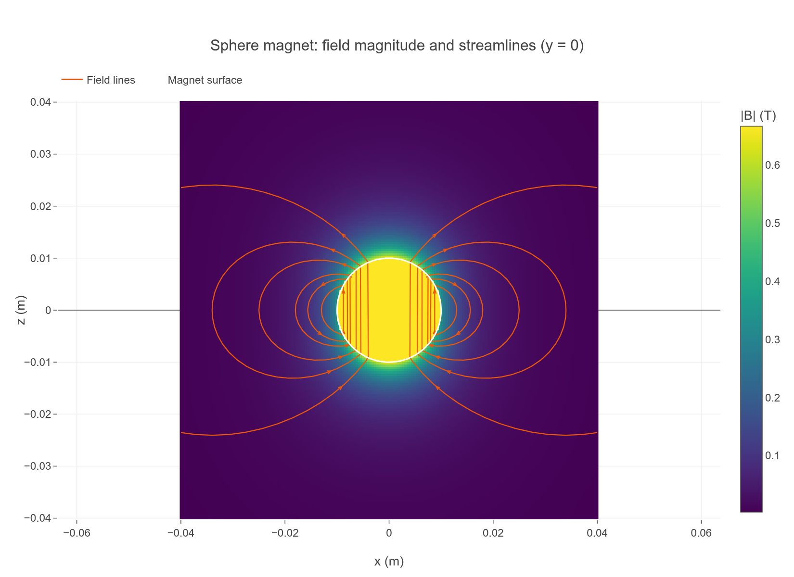

## 2D quiver

[Source](../field_quiver.rs). A 30 mm current loop carrying 10 A. Equal-length arrows
show the in-plane field direction; orange dots mark the wire cross-section.
Set `QuiverOptions::normalize` to false to make length proportional to field
magnitude, using `scale` in meters per tesla.

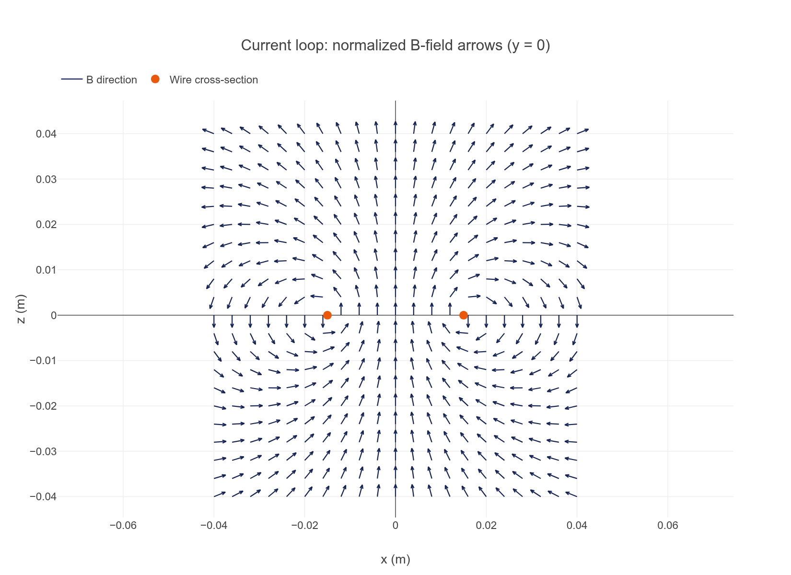

## 3D field lines and quiver

[Source](../field_3d.rs). The same sphere magnet, with trajectories integrated in
both directions from equatorial seeds and normalized B arrows sampled above it.

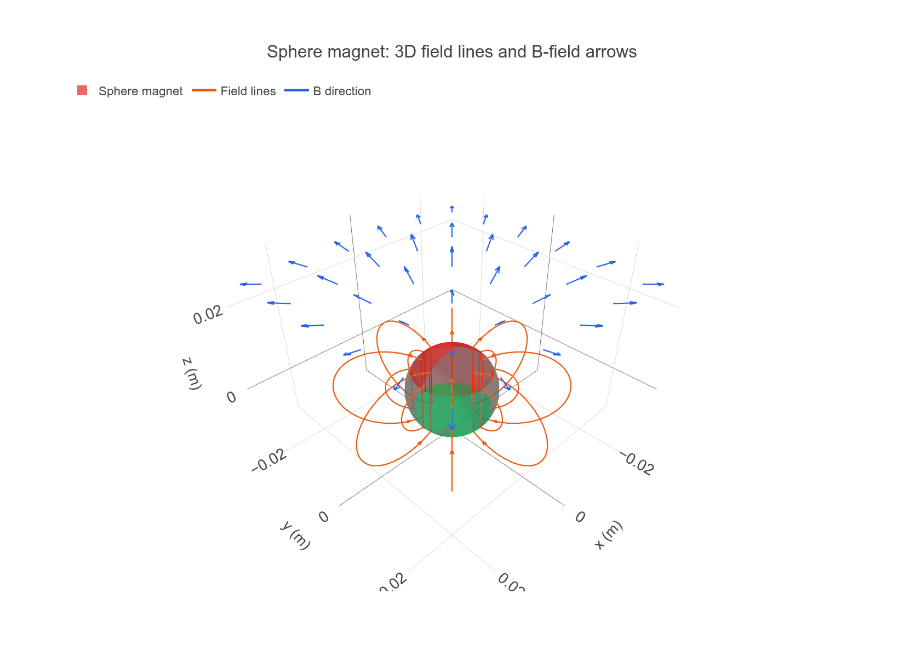

Field lines use adaptive arc-length RK4 integration with step doubling.
`step_size` sets the maximum step and `tolerance` controls the local error.
Decrease either to assess convergence, especially near material boundaries or thin wires. Tracing stops at
bounds, zero or non-finite fields, closed loops, or the step limit. A 2D streamline
follows the projected field and matches a 3D field line only where the normal
field component vanishes.

## Additional primitive and collection scenes

The cuboid, cylinder, tetrahedron, triangle, dipole, path-current, and
triangle-current examples each trace field lines from three rings of seeds.
The collection example combines two oppositely polarized magnets and a current
loop, tracing their total field. All share the output helper in `examples/common`.

Magnet surfaces use grey for neutral faces, red for north, and green for south.
The `graphics` example also shows the optional orange/blue (`OkabeIto`) and
red/blue (`Trad`) palettes. Run it with `cargo run --example graphics --features graphics-plotly`.

[Cuboid magnet source](../field_cuboid.rs)

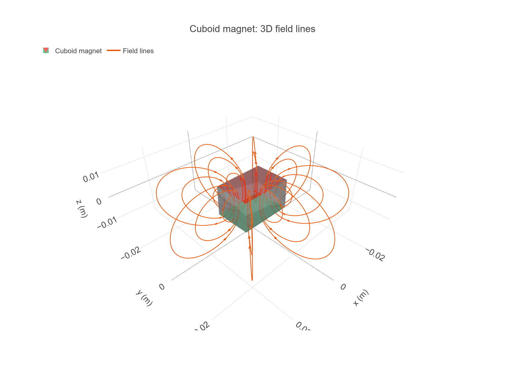

[Cylinder magnet source](../field_cylinder.rs)

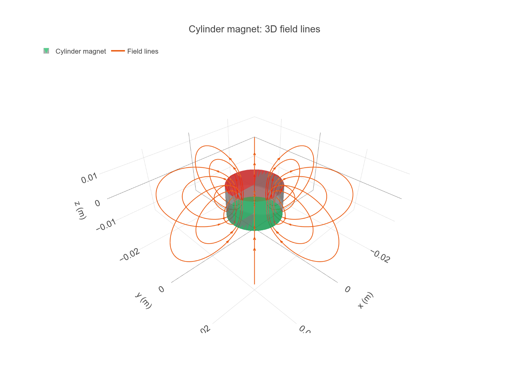

[Tetrahedron magnet source](../field_tetrahedron.rs)

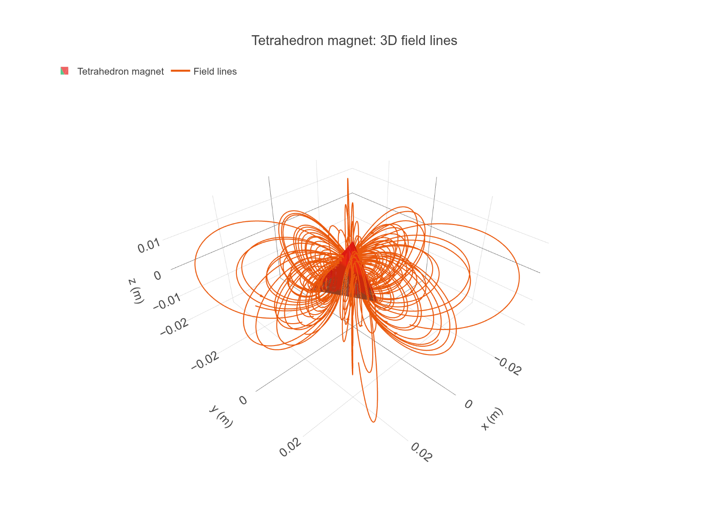

[Triangle magnet source](../field_triangle.rs)

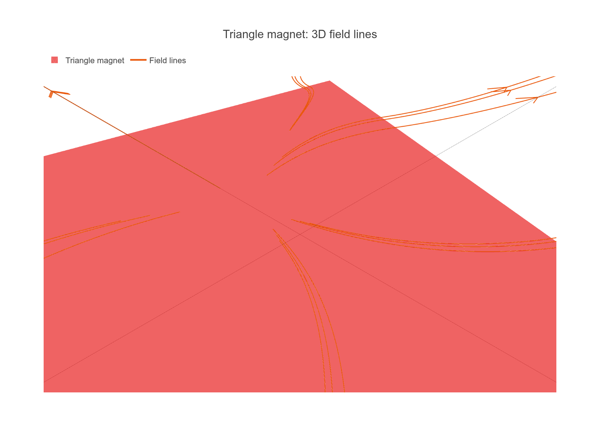

[Point dipole source](../field_dipole.rs)

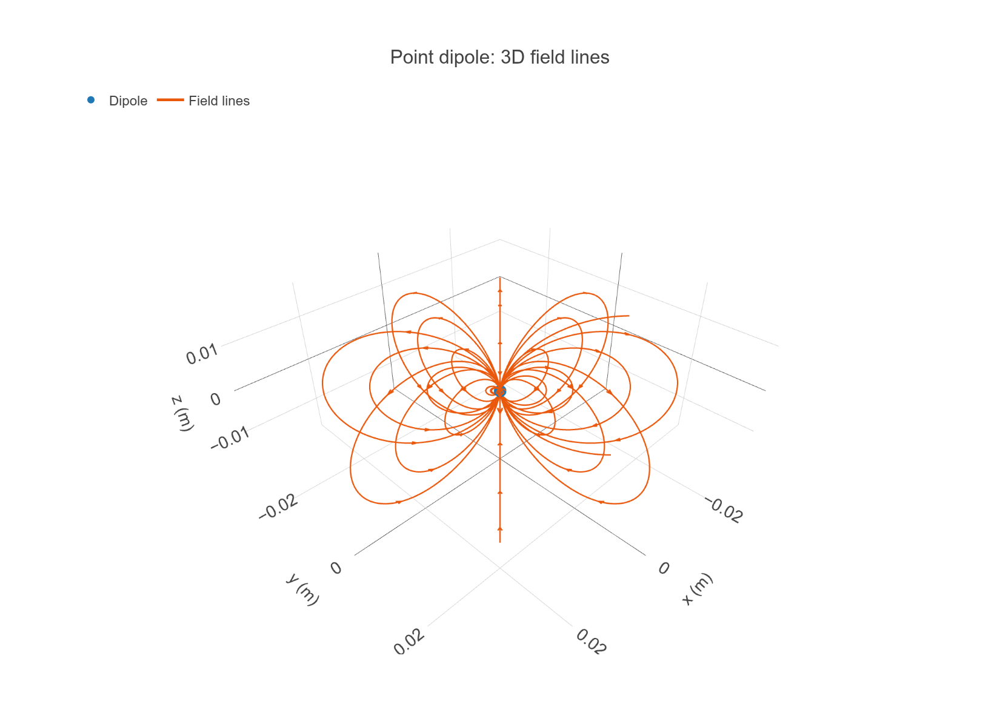

[Square current loop source](../field_path_current.rs)

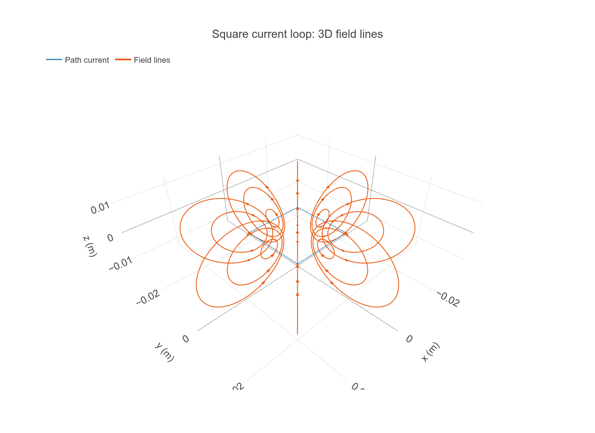

[Triangular current sheet source](../field_triangle_current.rs)

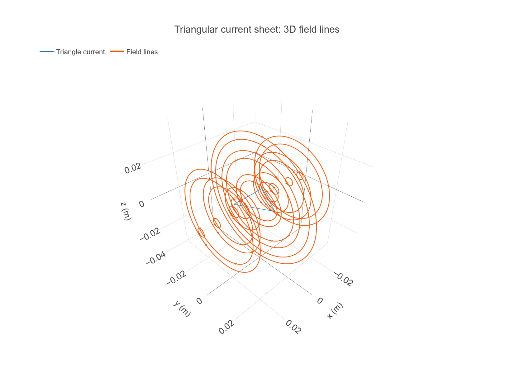

[Mixed source collection source](../field_collection.rs)

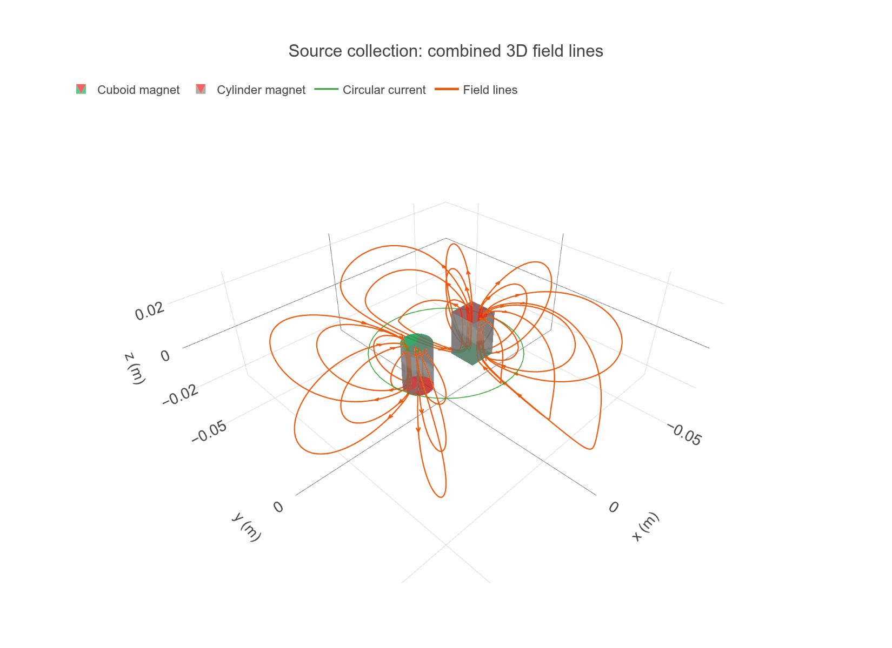

## 2×2 graphics showcase

[Source](../graphics_showcase.rs). Geometry, sensors, collections, heatmaps,
normalized 2D/3D quivers, and field lines with direction arrowheads in one figure.

```sh
cargo run --example graphics_showcase --features graphics-plotly
```

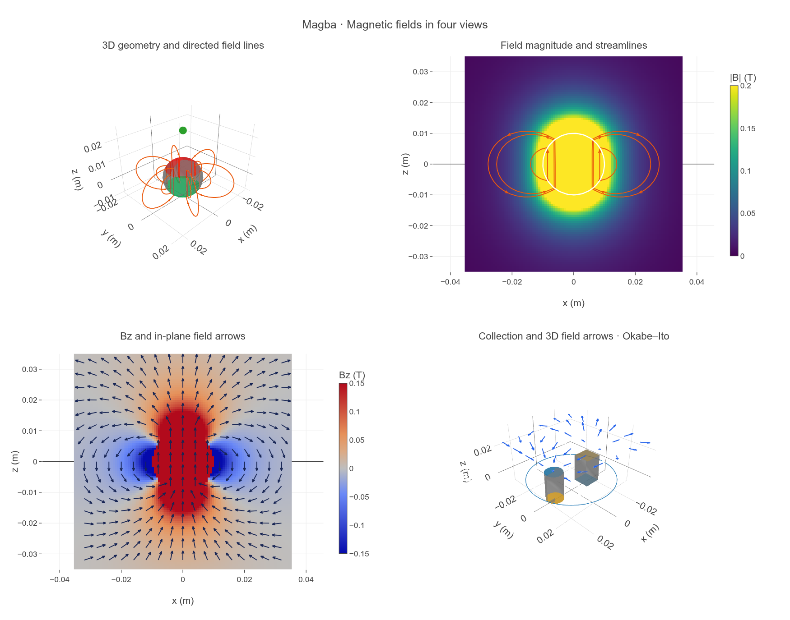
