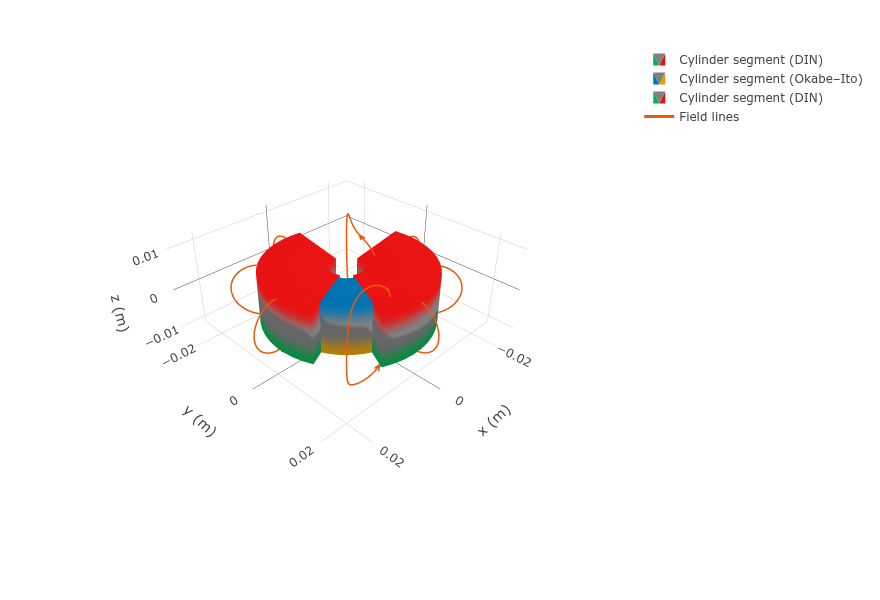

# Graphics

Three angular sectors share one center and height. A smaller, oppositely
polarized Okabe–Ito sector (40° opening and shorter outer radius) lies
between two broad DIN sectors. Their combined field lines are rendered with
[`FieldGraphics`](crate::graphics::FieldGraphics).
Requires the `graphics-plotly` feature.
